# SmartCarbure – Document d'architecture

> Projet Développement Logiciel (PDL) – Master 1 MIAGE
> ISTIC, Université de Rennes – Année 2026/2027

Ce document décrit l'architecture de SmartCarbure : les modèles statiques (architecture générale, organisation des packages, classes principales et leurs responsabilités) et les modèles dynamiques (cas d'utilisation, flux des événements, scénarios nominaux et exceptionnels, états).

Les diagrammes sont réalisés en UML avec PlantUML. Leurs sources (`.puml`) et leurs images (`.png`) se trouvent dans le dossier [`docs/diagrammes`](docs/diagrammes).

*Ce document reflète la conception actuelle du projet. Il sera mis à jour à chaque livraison (V1, V2) pour suivre l'évolution du code.*

---

## Sommaire

1. [Vue d'ensemble](#1-vue-densemble)
2. [Architecture générale](#2-architecture-générale)
3. [Modèles statiques](#3-modèles-statiques)
4. [Modèles dynamiques](#4-modèles-dynamiques)
5. [Déploiement](#5-déploiement)
6. [Choix de conception](#6-choix-de-conception)

---

## 1. Vue d'ensemble

SmartCarbure est une application web qui permet de trouver les stations-service les moins coûteuses et/ou les plus proches de sa position, d'une ville ou d'un trajet.

Les données sur les stations (localisation, carburants vendus, prix, ruptures de stock, horaires, services) ne sont pas stockées par l'application : elles sont lues **en temps réel** depuis l'API ouverte du ministère de l'Économie. La base de données de l'application ne contient que les données propres aux utilisateurs (comptes, favoris, préférences).

| Source externe | Rôle |
|---|---|
| API Prix des carburants – Flux instantané v2 (data.economie.gouv.fr) | Stations, carburants, prix, ruptures, horaires, services |
| Service d'itinéraire (OSRM ou OpenRouteService) | Calcul du trajet entre un départ et une arrivée (uniquement pour la recherche le long d'un trajet) |

---

## 2. Architecture générale

L'application suit une **architecture client-serveur en 3 tiers**, où le frontend et le backend communiquent uniquement en JSON via une **API REST**.

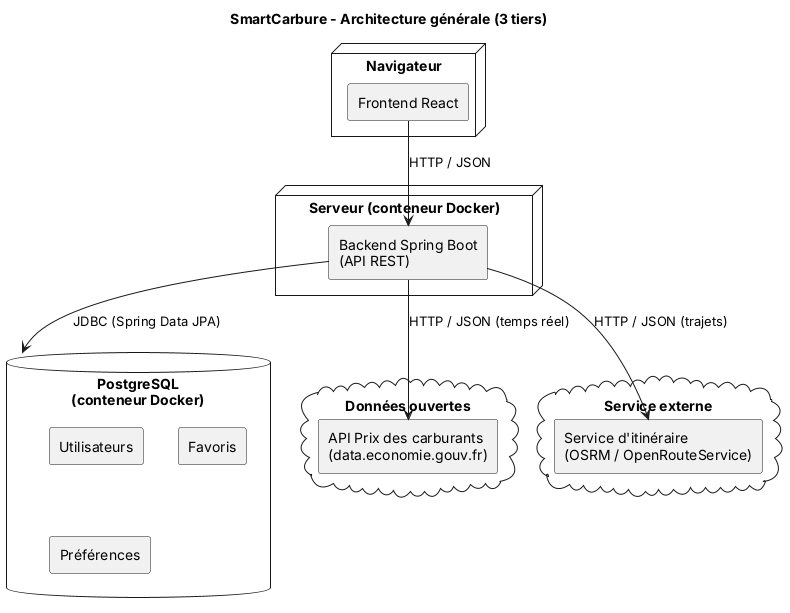

| Tiers | Technologie | Responsabilité |
|---|---|---|
| Présentation | React | Afficher les pages et la carte, envoyer les requêtes au backend |
| Logique métier | Java, Spring Boot | Appeler les API externes, filtrer, trier, calculer les distances, gérer les comptes |
| Données | PostgreSQL | Stocker les utilisateurs, leurs favoris et leurs préférences |

### 2.1 Architecture du backend

Le backend suit une **architecture en couches** (Controller – Service – Client / Repository). Chaque couche n'appelle que la couche située en dessous.

| Couche | Responsabilité |
|---|---|
| `controller` | Recevoir les requêtes HTTP, valider les paramètres, renvoyer du JSON |
| `service` | Logique métier : recherche, filtres, tri, calcul de distance, gestion des comptes et favoris |
| `client` | Appeler les API externes et convertir leur JSON en objets Java |
| `repository` | Accéder à PostgreSQL (Spring Data JPA) |
| `model` | Classes métier (Station, Carburant, Utilisateur…) |
| `dto` | Objets échangés avec le frontend |
| `exception` | Exceptions métier et gestion centralisée des erreurs |
| `config` | Configuration (sécurité, CORS, URL des API) |

### 2.2 Architecture du frontend

Le frontend suit une **architecture à composants**, qui sépare l'affichage de l'accès aux données.

| Dossier | Responsabilité |
|---|---|
| `pages` | Un écran complet, lié à une route (recherche, résultats, fiche station, connexion, favoris) |
| `components` | Éléments réutilisables sans appel API (carte d'une station, filtres, carte Leaflet) |
| `services` | Tous les appels HTTP vers le backend |
| `hooks` | Logique réutilisable (chargement, erreurs, géolocalisation) |
| `context` | État partagé, notamment l'utilisateur connecté |

La carte est affichée avec **Leaflet** (react-leaflet) sur un fond **OpenStreetMap**.

---

## 3. Modèles statiques

### 3.1 Organisation des packages du backend

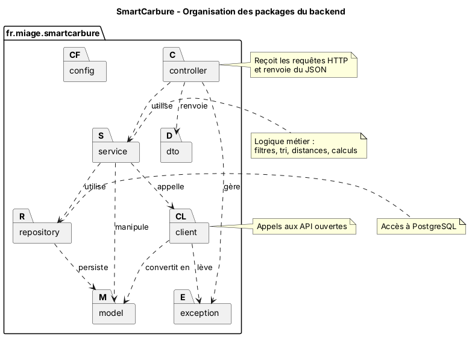

```
backend/src/main/java/fr/miage/smartcarbure/
├── controller/
├── service/
├── client/
├── repository/
├── model/
├── dto/
├── exception/
├── config/
└── SmartCarbureApplication.java
```

### 3.2 Diagramme de classes (modèle métier)

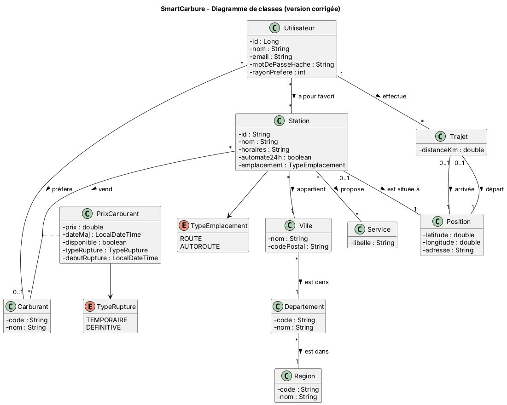

### 3.3 Classes principales et responsabilités

| Classe | Responsabilité |
|---|---|
| `Station` | Point de vente : identifiant de l'API, nom, horaires, automate 24h/24, emplacement (route ou autoroute) |
| `Position` | Coordonnées GPS (latitude, longitude) et adresse ; utilisée pour une station et pour les points d'un trajet |
| `Ville`, `Departement`, `Region` | Découpage géographique ; permet de rechercher par ville et de comparer des zones |
| `Service` | Service proposé par une station (lavage, boutique, gonflage…) |
| `Carburant` | Type de carburant (Gazole, SP95, SP98, E10, E85, GPLc) |
| `PrixCarburant` | Classe d'association entre `Station` et `Carburant` : prix, date de mise à jour, disponibilité, type et début de rupture |
| `Utilisateur` | Compte utilisateur : identité, email, mot de passe haché, rayon de recherche préféré |
| `Trajet` | Itinéraire entre une position de départ et une position d'arrivée |
| `TypeEmplacement` | Énumération : `ROUTE` ou `AUTOROUTE` (champ `pop` de l'API : R ou A) |
| `TypeRupture` | Énumération : `TEMPORAIRE` ou `DEFINITIVE` |

### 3.4 Principales associations

| Association | Multiplicité | Signification |
|---|---|---|
| Station – Ville | * – 1 | Une station appartient à une ville |
| Ville – Departement – Region | * – 1 | Une ville est dans un département, lui-même dans une région |
| Station – Service | * – * | Une station propose plusieurs services |
| Station – Carburant (via `PrixCarburant`) | * – * | Une station vend plusieurs carburants, chacun avec son prix et sa disponibilité |
| Station – Position | 0..1 – 1 | Une station est située à une position |
| Trajet – Position | départ et arrivée | Un trajet a une position de départ et une position d'arrivée |
| Utilisateur – Station | * – * | Un utilisateur a des stations favorites |
| Utilisateur – Carburant | * – 0..1 | Un utilisateur peut choisir un carburant préféré |
| Utilisateur – Trajet | 1 – * | Un utilisateur effectue des trajets |

### 3.5 Données persistées

| Données | Stockage |
|---|---|
| Stations, prix, ruptures, horaires, services | Non stockées : lues en temps réel depuis l'API |
| Utilisateurs, favoris (identifiant de station), préférences | PostgreSQL |

---

## 4. Modèles dynamiques

### 4.1 Diagramme de cas d'utilisation

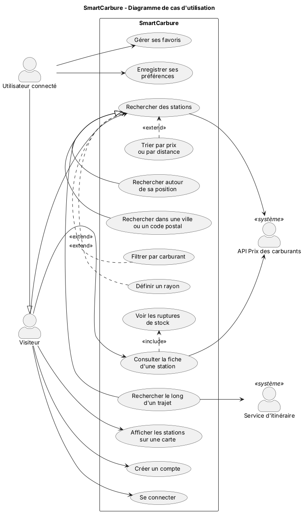

| Acteur | Description |
|---|---|
| Visiteur | Utilise l'application sans compte : recherche, fiche station, carte |
| Utilisateur connecté | Hérite du visiteur ; gère en plus ses favoris et ses préférences |
| API Prix des carburants | Fournit les stations et les prix |
| Service d'itinéraire | Calcule le trajet entre deux points |

### 4.2 Flux des événements : rechercher des stations autour de sa position

**Acteur principal :** Visiteur
**Précondition :** l'API Prix des carburants est accessible.

**Scénario nominal**

1. L'utilisateur clique sur « Me localiser », choisit un carburant, un rayon et un ordre de tri.
2. Le navigateur fournit la position GPS de l'utilisateur.
3. Le système interroge l'API Prix des carburants pour obtenir les stations situées dans le rayon.
4. Le système garde les stations qui vendent le carburant choisi.
5. Le système calcule la distance de chaque station.
6. Le système trie les stations par prix ou par distance.
7. Le système affiche la liste et les stations sur la carte.

**Variante :** l'utilisateur saisit une ville ou un code postal au lieu de sa position. Le système interroge directement l'API Prix des carburants avec ce nom de ville ou ce code postal (champs `ville` et `cp` de l'API).

**Scénarios exceptionnels**

| Étape | Situation | Réaction du système |
|---|---|---|
| 1 | Champs invalides (rayon hors limites, carburant non choisi) | Message d'erreur de saisie, aucune requête envoyée |
| 2 | Géolocalisation refusée par l'utilisateur | Message invitant à saisir une ville ou un code postal |
| Variante | Ville ou code postal inconnu | Message « Aucune station pour cette ville, vérifiez la saisie » |
| 3 | API Prix des carburants indisponible | Erreur 503, message clair et bouton « Réessayer » |
| 3 | Aucune station dans le rayon | Message « Aucune station trouvée, élargissez le rayon » |
| 4 | Carburant en rupture dans une station | La station est affichée avec un badge « Rupture » |

### 4.3 Diagramme de séquence : scénario nominal de la recherche

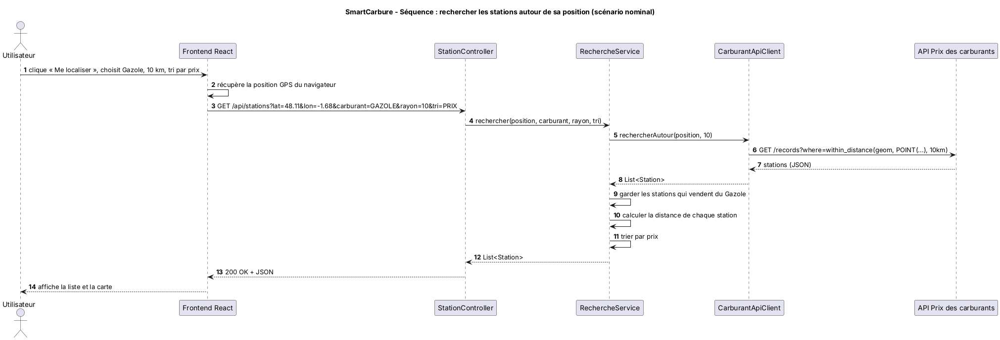

### 4.4 Diagramme de séquence : scénarios exceptionnels

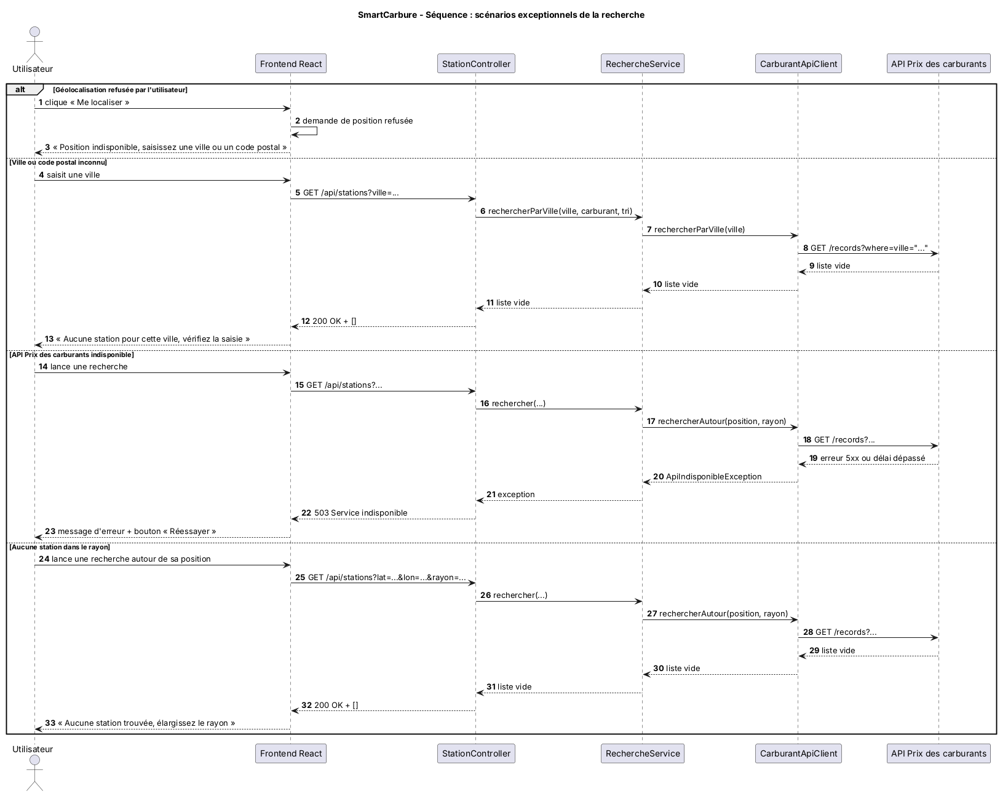

### 4.5 Diagramme de séquence : stations le long d'un trajet

1. L'utilisateur place les marqueurs de départ et d'arrivée sur la carte et choisit un carburant.
2. Le frontend envoie les coordonnées des deux marqueurs au backend.
3. Le système calcule l'itinéraire grâce au service d'itinéraire.
4. Le système recherche les stations autour de points répartis sur le trajet.
5. Le système supprime les doublons, filtre par carburant et trie par prix.
6. Le système trace l'itinéraire et affiche les stations sur la carte.

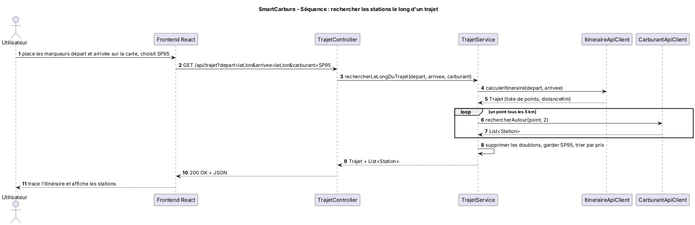

### 4.6 Diagramme de séquence : connexion et ajout d'un favori

**Scénario exceptionnel :** si l'email ou le mot de passe est incorrect, le système renvoie une erreur 401 et affiche « Email ou mot de passe incorrect ».

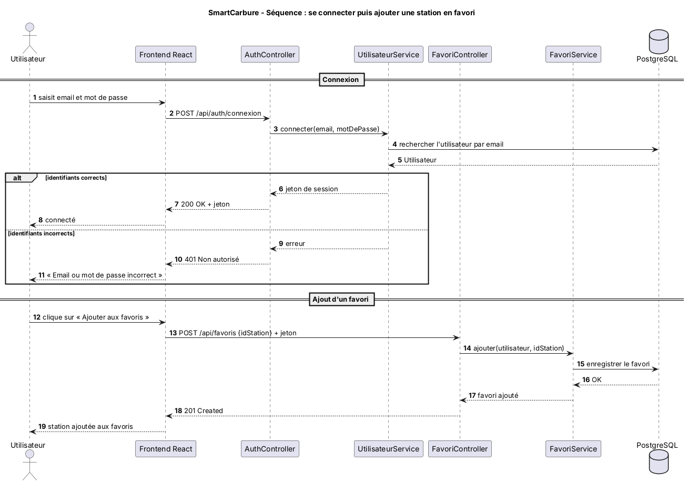

### 4.7 Diagramme d'états : écran de recherche

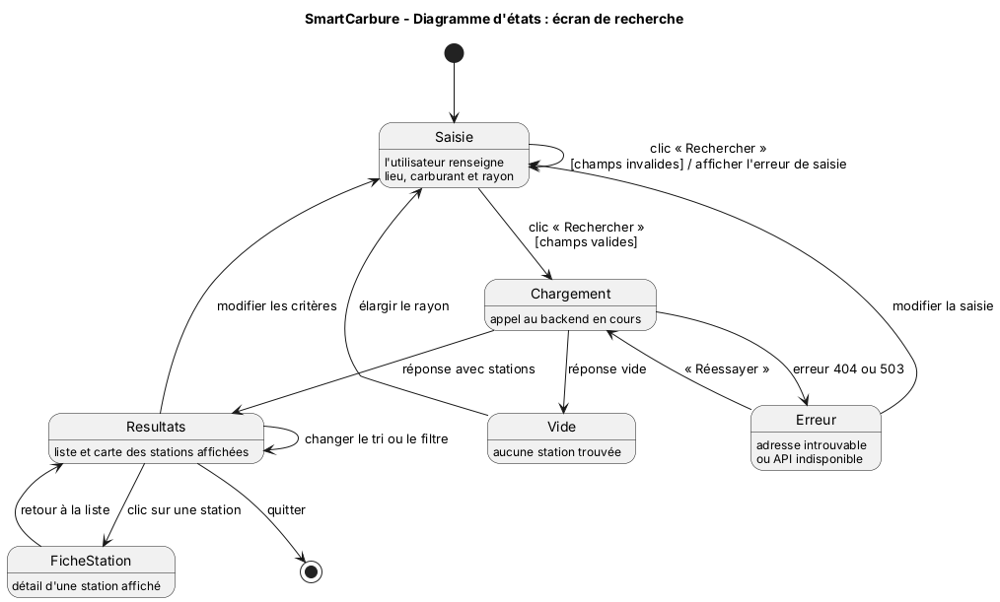

### 4.8 Diagramme d'états : disponibilité d'un carburant

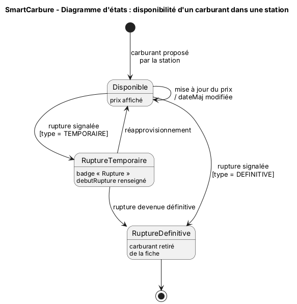

---

## 5. Déploiement

L'application est conteneurisée avec **Docker** et lancée avec **Docker Compose** (un conteneur par composant).

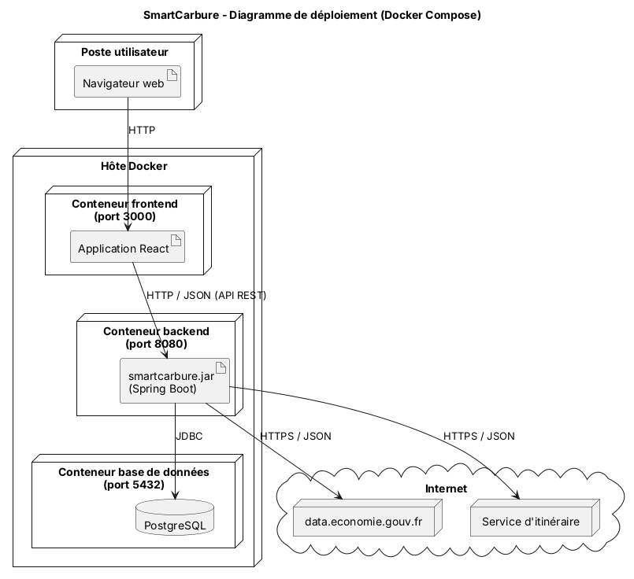

| Conteneur | Contenu | Port |
|---|---|---|
| frontend | Application React | 3000 |
| backend | Application Spring Boot | 8080 |
| base de données | PostgreSQL | 5432 |

---

## 6. Choix de conception

| Choix | Justification |
|---|---|
| Données lues en temps réel depuis l'API, sans copie locale | Les prix sont toujours à jour (flux mis à jour toutes les 10 minutes) et il n'y a pas de synchronisation à gérer |
| Une seule source de données ouvertes (API Prix des carburants) | Elle fournit tout ce qui concerne les stations : localisation, ville, code postal, carburants, prix, ruptures, horaires, services |
| Position de l'utilisateur fournie par le navigateur, départ et arrivée placés sur la carte | Pas besoin d'API de géocodage supplémentaire |
| Appels aux services externes faits par le backend, jamais par React | Clés d'API cachées, logique testable avec JUnit, frontend plus simple |
| Architecture en couches côté backend | Responsabilités séparées ; les services peuvent être testés en simulant les clients API avec Mockito |
| Classe d'association `PrixCarburant` | Le prix et la disponibilité dépendent à la fois de la station et du carburant |
| Énumérations `TypeEmplacement` et `TypeRupture` | Valeurs fixes et connues, plus sûres que des chaînes de caractères |
| Gestion centralisée des erreurs | L'application ne plante pas si une API externe est indisponible : elle renvoie un message clair |
| Docker Compose | Installation et lancement identiques pour tous les membres de l'équipe et pour le client |